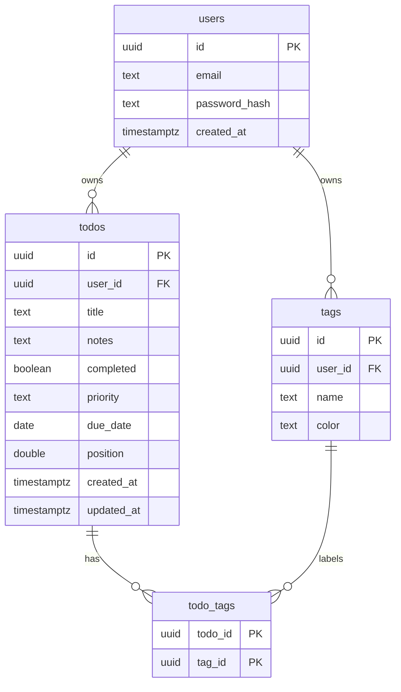

# todo26 — Fullstack Todo App

A production-shaped todo application with a React + TypeScript frontend, an Express + TypeScript
REST API, PostgreSQL persistence, cookie-based authentication, and Docker support.

## Features

- **Accounts** — register / sign in / sign out with bcrypt-hashed passwords and an httpOnly JWT session cookie.
- **Todos** — create, edit, complete, and delete, with notes, priority (`low` / `medium` / `high`), and due dates.
- **Tags** — per-user colored tags, assignable to todos, usable as filters.
- **Filtering & search** — all / active / completed, full-text search across titles, notes, and tags.
- **Sorting** — manual order, due date, priority, or newest first.
- **Drag & drop reordering** — persisted to the database via `@dnd-kit`.
- **Dark mode** — follows the OS preference, toggleable, persisted in `localStorage`.
- **Validation** — Zod schemas on every write endpoint; typed errors surfaced in the UI.
- **Tests** — 15 API integration tests (Vitest + Supertest) and 8 component tests (Vitest + Testing Library).

## Project layout

```
todo26/
├── client/                 React + TypeScript + Vite frontend
│   └── src/
│       ├── components/     AuthScreen, TodoForm, TodoList, TodoItem, TagManager
│       ├── auth.tsx        Session context
│       ├── theme.tsx       Dark mode context
│       ├── useTodos.ts     Todo/tag state, filtering, sorting
│       └── api.ts          Typed fetch wrapper
├── server/                 Express + TypeScript API
│   └── src/
│       ├── routes/         auth, todos, tags
│       ├── migrate.ts      Idempotent SQL migrations
│       ├── auth.ts         JWT session helpers
│       └── validation.ts   Zod schemas
├── Dockerfile
├── docker-compose.yml
└── nginx.conf
```

## Prerequisites

- Node.js 20 or newer
- PostgreSQL 14 or newer (or Docker)

## Quick start (local development)

1. **Install dependencies**

   ```bash
   npm install
   ```

2. **Create the database**

   ```bash
   createdb todo26
   # or: psql -U postgres -c "CREATE DATABASE todo26;"
   ```

3. **Configure the API**

   ```bash
   cp server/.env.example server/.env
   ```

   Then edit `server/.env` and set `DATABASE_URL` and a real `JWT_SECRET`.

4. **Run migrations**

   ```bash
   npm run migrate
   ```

5. **Start both apps**

   ```bash
   npm run dev
   ```

   - Frontend: http://localhost:5173
   - API: http://localhost:4000

   Vite proxies `/api` to the API server, so the browser only talks to port 5173.

## Quick start (Docker)

```bash
npm install && npm run build   # produces client/dist for nginx to serve
JWT_SECRET="a-long-random-secret-value" docker compose up --build
```

- App: http://localhost:8080
- API: http://localhost:4000

The API container runs migrations automatically on startup.

## Scripts

| Command | Description |
| --- | --- |
| `npm run dev` | Run API and frontend together |
| `npm run dev:server` | Run only the API (watch mode) |
| `npm run dev:client` | Run only the frontend |
| `npm run build` | Build the API and the frontend |
| `npm start` | Run the built API |
| `npm run migrate` | Apply database migrations |
| `npm test` | Run API and frontend test suites |
| `npm run typecheck` | Typecheck the API and build the frontend |
| `npm run lint` | Lint the frontend |

## API reference

All endpoints are prefixed with `/api`. Authentication uses an httpOnly cookie set by
`/api/auth/login` and `/api/auth/register`; a `Bearer` token is also accepted.

### Auth

| Method | Path | Description |
| --- | --- | --- |
| `POST` | `/auth/register` | Create an account and start a session |
| `POST` | `/auth/login` | Start a session |
| `POST` | `/auth/logout` | Clear the session cookie |
| `GET` | `/auth/me` | Return the current user |

### Todos

| Method | Path | Description |
| --- | --- | --- |
| `GET` | `/todos` | List the current user's todos |
| `POST` | `/todos` | Create a todo |
| `PATCH` | `/todos/:id` | Update a todo |
| `PATCH` | `/todos/reorder` | Persist a new manual order |
| `DELETE` | `/todos/:id` | Delete a todo |

### Tags

| Method | Path | Description |
| --- | --- | --- |
| `GET` | `/tags` | List the current user's tags |
| `POST` | `/tags` | Create a tag |
| `PATCH` | `/tags/:id` | Rename or recolor a tag |
| `DELETE` | `/tags/:id` | Delete a tag |

### Example

```bash
curl -c cookies.txt -X POST http://localhost:4000/api/auth/register \
  -H 'Content-Type: application/json' \
  -d '{"email":"me@example.com","password":"password123"}'

curl -b cookies.txt -X POST http://localhost:4000/api/todos \
  -H 'Content-Type: application/json' \
  -d '{"title":"Ship it","priority":"high","dueDate":"2026-11-01"}'
```

## Data model



## Security notes

- Passwords are hashed with bcrypt (cost 12) and never returned by the API.
- Sessions are signed JWTs stored in `httpOnly`, `SameSite=Lax` cookies (`Secure` in production).
- Every todo and tag query is scoped by `user_id`, so users cannot read or mutate each other's data.
- All SQL uses parameterized queries.
- `helmet` sets security headers; CORS is restricted to `CORS_ORIGIN`.
- Request bodies are limited to 100 kB and validated with Zod before touching the database.

Set a strong `JWT_SECRET` before deploying — the server refuses to start in production with the
development default.
